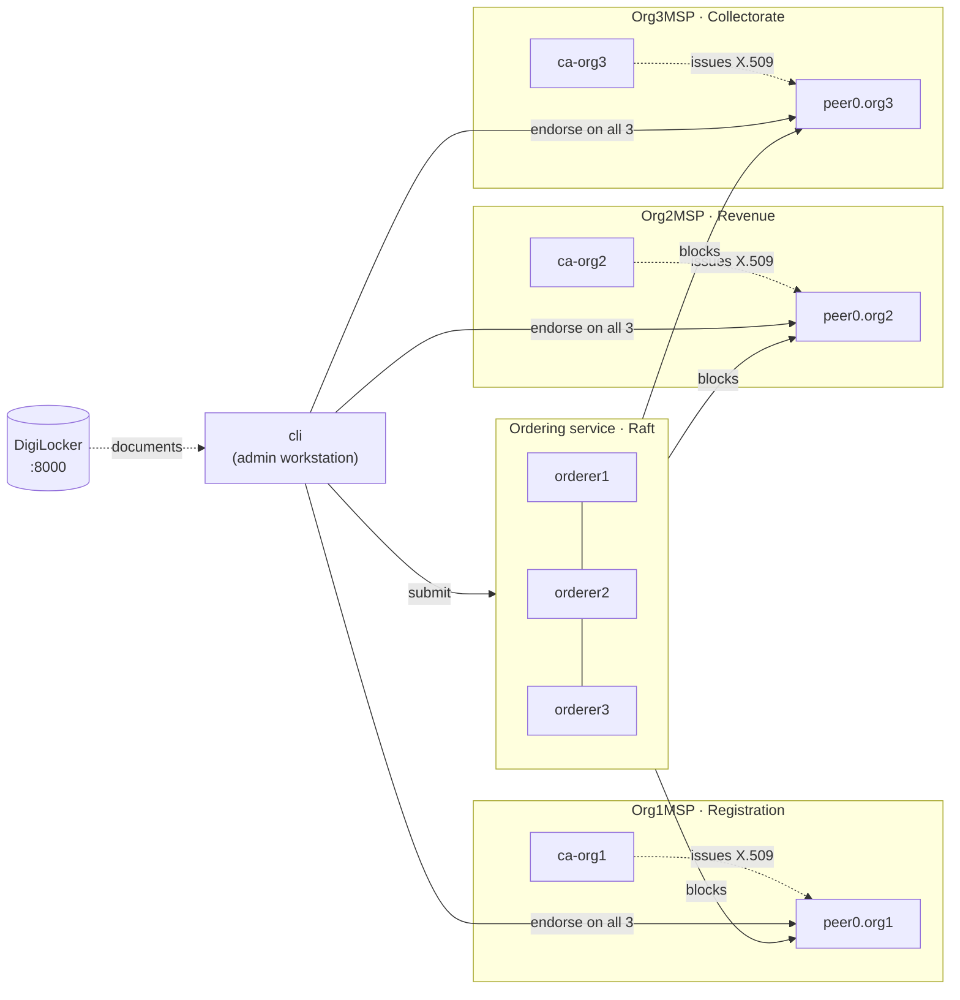

# LandChain

A permissioned blockchain for land registration: three government departments share one Hyperledger Fabric ledger. Each department issues its own X.509 identities, and no department can change a land record on its own.

| Department | MSP | Does |
|---|---|---|
| Registration | `Org1MSP` | registers parcels, opens transfer files, anchors DigiLocker documents |
| Revenue | `Org2MSP` | independently re-verifies documents, records the field survey |
| Collectorate | `Org3MSP` | the human decision: approve (ownership moves) or reject |

Documents stay in **DigiLocker**. Only their SHA-256 fingerprints go on the ledger, and no Aadhaar number is ever stored on-chain.

---

## Quick start

```bash
./initial_setup.sh     # once: certificates, network, channel, chaincode   (~5-10 min first time)
./startup.sh           # start + run the automated land-transfer transactions
./shutdown.sh          # stop; ledger and certificates are kept
```

| Command | What it does |
|---|---|
| `./initial_setup.sh` | Issues X.509 certificates to all three departments, starts 12 containers, creates `landchannel`, deploys the `landrec` chaincode |
| `./initial_setup.sh --force` | Wipes everything and sets up again |
| `./startup.sh` | Starts the network (resuming the existing ledger) and runs `demo_transactions.sh` |
| `./startup.sh --no-demo` | Starts the network only |
| `./demo_transactions.sh` | Runs the automated transactions against a running network |
| `DEMO_PAUSE=2 ./demo_transactions.sh` | Same, with a pause between acts (for presenting live) |
| `./shutdown.sh` | Stops everything and keeps all data |
| `./shutdown.sh --clean` | Deletes ledger, certificates, chaincode images (asks first) |

### Prerequisites

- **Docker Desktop** (Mac/Windows) or Docker Engine + Compose plugin (Linux). Nothing else from Hyperledger needs installing: `fabric-ca-client`, `configtxgen`, `osnadmin` and `peer` all run inside containers.
- **`jq` and `curl`** on the host, for the demo (macOS: `brew install jq`).

**Docker Desktop settings (Mac):**
- *Resources → Memory:* at least **6 GB**.
- *Advanced:* tick **"Allow the default Docker socket to be used"**. The peers build the chaincode through `/var/run/docker.sock`, and chaincode install fails without it.

---

## What the automated transactions show

`demo_transactions.sh` runs seven acts. Each write is signed by a real CA-issued certificate, endorsed by all three departments' peers, ordered by Raft, and committed.

1. **Identities.** Each user's X.509 certificate, as read by the chaincode: MSP, `role`, `dept`.
2. **DigiLocker.** A seller and a buyer sign up. The Sub-Registrar issues a sale deed and an encumbrance certificate into the seller's locker.
3. **Registration (Org1).**
   - The registrar records the parcel.
   - The clerk files the transfer, which locks the parcel against a second sale.
   - The clerk fetches the documents through DigiLocker consent + OTP and anchors their fingerprints.
   - The registrar forwards the file to Revenue.
4. **Revenue (Org2).**
   - The verifier fetches the documents again through its own consent request, hashes them locally, and the chaincode compares them with Org1's anchors.
   - The surveyor records the measured area. The chaincode computes its deviation from the recorded area against a 5% tolerance.
5. **Collectorate (Org3).** The collector approves, and ownership moves on the ledger.
6. **Attacks the network refuses:**
   - a Registration clerk trying to approve a transfer (refused because of the certificate's MSP and role)
   - the previous owner selling the parcel again
   - a deed altered after anchoring (fingerprint mismatch → `FLAGGED` on the ledger → rejected, parcel released)
   - one deed reused to back a second transfer
7. **Audit.** A public document check, the parcel's full ownership history from the ledger, and who-did-what on the file.

---

## Architecture



| Piece | Where |
|---|---|
| Channel config (3 orgs, 3-node Raft) | `network/configtx.yaml` |
| Containers | `network/docker-compose.yaml` |
| X.509 issuance | `network/scripts/issue_certs.sh` (runs in a Fabric CA container) |
| Channel creation | `network/scripts/create_channel.sh` (runs in `cli`) |
| Chaincode lifecycle | `network/scripts/deploy_chaincode.sh` (runs in `cli`) |
| Call the chaincode as any identity | `network/scripts/cc.sh` |
| Smart contract | `chaincode/landrec/lib/landRegistry.js` |
| DigiLocker clone | `digilocker/app.py` |

### Identities (all issued by `initial_setup.sh`)

| Identity | Issued by | OU | `role` | `dept` |
|---|---|---|---|---|
| `orderer1..3.landchain.example` | ca-orderer | orderer | – | – |
| `peer0.orgN.landchain.example` | ca-orgN | peer | – | – |
| `Admin@orgN.landchain.example` | ca-orgN | admin | – | – |
| `registrar1@org1` | ca-org1 | client | registrar | registration |
| `clerk1@org1` | ca-org1 | client | clerk | registration |
| `verifier1@org2` | ca-org2 | client | verifier | revenue |
| `surveyor1@org2` | ca-org2 | client | surveyor | revenue |
| `collector1@org3` | ca-org3 | client | collector | collectorate |

`role` and `dept` are embedded in the certificate by the issuing CA (`--id.attrs role=clerk:ecert`). On every transaction the chaincode checks **both** the MSP (which department issued the certificate) and the role. Nothing about the caller is taken from transaction arguments.

### Chaincode `landrec`

Endorsement policy: `AND('Org1MSP.peer','Org2MSP.peer','Org3MSP.peer')`.

| Function | Who may call |
|---|---|
| `RegisterParcel`, `ForwardToRevenue` | Org1 · registrar |
| `SubmitTransferApplication`, `AnchorDocument` | Org1 · clerk |
| `VerifyDocuments`, `ForwardToCollectorate` | Org2 · verifier |
| `RecordSurvey` | Org2 · surveyor |
| `ApproveTransfer`, `RejectApplication` | Org3 · collector |
| `WhoAmI`, `ReadParcel`, `ReadApplication`, `VerifyDocument`, `ParcelHistory`, `ApplicationHistory`, `ListApplications`, `ListParcels` | any channel member |

Application lifecycle:
`SUBMITTED → WITH_REVENUE → DOCS_VERIFIED → SURVEYED → WITH_COLLECTORATE → APPROVED`.
A fingerprint mismatch goes to `FLAGGED`, and the Collectorate can reject from any open state.

### Ports (host)

| Service | Port |
|---|---|
| orderer1 / 2 / 3 | 12050 / 12060 / 12070 (admin 12053 / 12063 / 12073) |
| peer0.org1 / org2 / org3 | 12151 / 12251 / 12351 |
| ca-orderer / org1 / org2 / org3 | 12054 / 12154 / 12254 / 12354 |
| DigiLocker (Swagger UI at `/docs`) | 8000 |

These are chosen to avoid the previous batch's network (7xxx–11xxx), so both can run on one machine.

---

## Talking to the chaincode by hand

```bash
# who am I, according to my certificate?
docker exec cli bash /work/network/scripts/cc.sh query 1 clerk1 WhoAmI

# list every application
docker exec cli bash /work/network/scripts/cc.sh query 3 collector1 ListApplications ALL

# try something you're not allowed to do
docker exec cli bash /work/network/scripts/cc.sh invoke 2 surveyor1 ApproveTransfer APP-X "nope"
```

---

## From automated to user-generated transactions

Every ledger call in `demo_transactions.sh` goes through the `tx` / `q` helpers, and those map one-to-one onto chaincode functions. To make the transactions user-driven, put a small REST API in front of the peers (the Fabric Gateway SDK, `@hyperledger/fabric-gateway`). Each logged-in user's certificate then signs their own transactions. The network, certificates and chaincode don't change.

The `ForwardToRevenue` step emits a `HandoffToRevenue` event. That is the Org1 → Org2 handoff, and where an off-chain verification agent can subscribe.

---

## Troubleshooting

| Symptom | Fix |
|---|---|
| Chaincode install fails / `cannot connect to the Docker daemon` inside the peer | Docker Desktop → Advanced → *Allow the default Docker socket to be used*, restart Docker, then `./initial_setup.sh --force` |
| `These ports are already in use` | Stop whatever holds them. For the previous batch's network, their ports don't overlap with these. |
| Setup failed half-way | `./initial_setup.sh --force` |
| DigiLocker OTP | Fixed at `123456`. Also printed by `docker logs digilocker`. |
| `jq is required` | `brew install jq` |
| Logs | `docker logs peer0.org1.landchain.example`, `docker logs orderer1.landchain.example`, `docker logs ca-org1` |

---

## How this was tested

The network was run end to end with the real **Fabric 2.5.16** and **Fabric CA 1.5.17** release binaries, using the same hostnames, ports, certificates and scripts:

- **Certificates:** `issue_certs.sh` ran under `dash` (the CA image's `/bin/sh`) against four real CA servers.
- **Channel:** three Raft orderers elected a leader and all three peers joined the channel.
- **Chaincode:** installed, approved by all three orgs, and committed.
- **Lifecycle scripts:** `initial_setup.sh`, `startup.sh`, `shutdown.sh` and `demo_transactions.sh` all ran unmodified.
- **Persistence:** the ledger survived stop/start.
- **Edge cases:** 13 rejection cases returned the right errors.
- **Crash tolerance:** killing the Raft leader, and separately a non-leader orderer, did not stop transactions from committing.

The one path that runs only under Docker is the peer building the Node.js chaincode image. In testing, the identical chaincode ran as an external service instead, while the `peer lifecycle chaincode package --lang node` output was checked separately. `docker compose config` validates the compose file.
